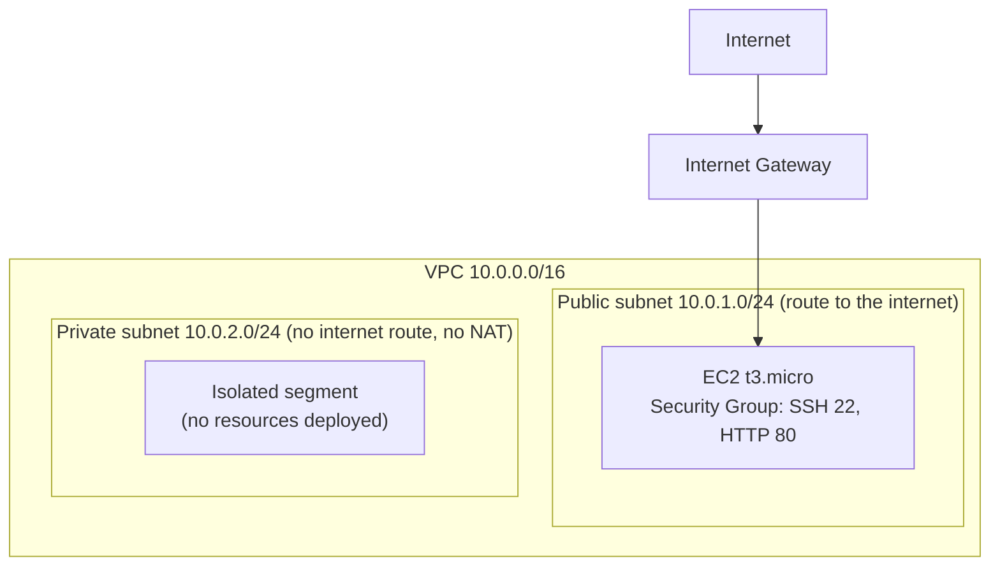

# VPC Networking Project

📖 Want the full, beginner-friendly walkthrough of every step, command,
and decision made in this project? See
[PROJECT_GUIDE.md](./PROJECT_GUIDE.md).

## What is this project, in one sentence?

A hands-on networking project: a private virtual network in AWS (VPC)
with a public and a private subnet, a small web server, and a firewall —
built with Terraform, deployed through CI/CD, and torn down on demand to
avoid unnecessary cost.

## Why this project exists

The first two projects in this series
([terraform-cicd-project](https://github.com/Ralso11/terraform-cicd-project),
[lambda-api-project](https://github.com/Ralso11/lambda-api-project))
focused on *what* runs (a static site, a serverless API). This one
focuses on something almost every cloud job interview asks about but
most beginner portfolios skip: **how traffic actually flows into and
around a cloud environment.**

## Architecture

- **VPC** — your own private network space in AWS (`10.0.0.0/16`).
- **Public subnet** — has a route to the internet via an Internet
  Gateway; the EC2 instance lives here.
- **Private subnet** — intentionally has *no* route to the internet
  (no NAT Gateway was added, to avoid its hourly cost) — a genuinely
  isolated network segment, exactly what you'd use for something like a
  database that should never be directly reachable.
- **Security Group** — a firewall on the EC2 instance, allowing only SSH
  (22) and HTTP (80) inbound.
- **EC2 instance** — a small `t3.micro` server (free-tier eligible),
  running the latest Amazon Linux 2023 image, found automatically via a
  Terraform data source rather than a hardcoded, aging AMI ID.

## A deliberate cost decision: no NAT Gateway

A NAT Gateway is what would let the *private* subnet reach the internet
(for things like software updates) while staying unreachable *from* the
internet. It costs money per hour, regardless of usage, and isn't
covered by the free tier. Since this project's private subnet exists to
demonstrate the *concept* of network isolation rather than to run
anything that needs outbound internet access, it was deliberately left
out — a real cost-vs-need tradeoff, not an oversight.

## Turning this on and off (cost management)

This project includes two pipelines:
- **`terraform.yml`** — runs automatically on every push; deploys the
  infrastructure (with manual approval before anything real happens).
- **`destroy.yml`** — a manual, one-click workflow (find it under the
  Actions tab → "Destroy Infrastructure" → Run workflow) that tears
  everything down on demand.

Because AWS accounts created after July 2025 use a **credit-based** free
plan rather than the older always-free-within-limits model, this
project's infrastructure is torn down after each demo/verification
rather than left running indefinitely, to avoid drawing down that
credit unnecessarily. Redeploying takes one click and a couple of
minutes whenever it's needed again (e.g. for an interview demo).

## Problems & fixes — quick reference

| Problem | Why it happened | How it was fixed |
|---|---|---|
| `terraform fmt -check` failed in the pipeline | Inconsistent spacing/alignment in `main.tf` (Terraform enforces a strict, consistent style) | Rewrote the file with correctly aligned formatting |
| EC2 instance creation failed: "not eligible for Free Tier" | AWS changed free-tier eligible instance types for accounts created after July 15, 2025 — `t2.micro` (the classic tutorial default) is no longer included; `t3.micro`, `t3.small`, `t4g.micro`, `t4g.small` are | Switched the instance type to `t3.micro` |
| Didn't want to leave real AWS resources (and free-tier credit) running indefinitely | Newer AWS accounts use a time-limited credit pool, not unlimited always-free usage | Added a manual `destroy.yml` workflow to tear infrastructure down after each verification, redeployable on demand |

## How to reproduce this project

1. Install Git and Terraform.
2. Create a GitHub repo, clone it locally.
3. Write Terraform for a VPC, public + private subnets, an internet
   gateway, a route table, a security group, and an EC2 instance (using
   a data source to find the latest AMI automatically).
4. Create a dedicated IAM user with `AmazonVPCFullAccess` +
   `AmazonEC2FullAccess`, plus a small custom policy scoped to your
   Terraform state bucket.
5. Store the keys as GitHub Secrets, set up a protected `production`
   environment with required reviewers.
6. Write two pipelines: one that plans/applies on push, one manual
   workflow (`workflow_dispatch`) that destroys on demand.
7. Push, approve, verify — then destroy when done, redeploy when needed.

## What's next (possible future additions)

- [ ] Restrict the security group's SSH rule to a specific IP instead of
      `0.0.0.0/0` (anywhere) — a realistic production hardening step.
- [ ] Add a NAT Gateway as an optional, cost-aware toggle (a Terraform
      variable to turn it on only when actually needed).
- [ ] Add a second EC2 instance in the private subnet to demonstrate
      true internal-only communication between instances.
